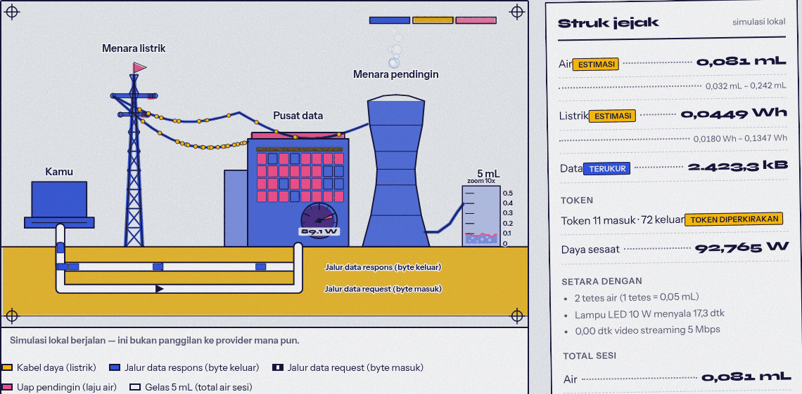

[](https://github.com/Baby-Angel404/jejak-ai/actions/workflows/ci.yml)

# Jejak AI

**"Satu prompt, berapa air?"**



Jejak AI mengukur dan menganimasikan jejak **air, listrik, dan data** setiap kali kamu
mengirim prompt ke provider AI, lalu menampilkannya sebagai satu adegan berpenampang:
laptop "Kamu", menara listrik, gedung pusat data dengan meteran daya, menara pendingin
yang mengepulkan uap, gelas ukur 5 mL, dan dua jalur data bawah tanah.

Transparansi adalah aturan mainnya:

| Angka | Status | Sumber |
|---|---|---|
| Token | **terukur** | `usage` provider; pendekatan ~4 karakter/token bila provider tidak mengirim usage (ditandai "diperkirakan") |
| Byte | **terukur** | blok header + body request yang benar-benar dikirim, dan jumlah byte mentah dari chunk respons upstream |
| Listrik (Wh) | **estimasi** | `(in/1000 × e_in + out/1000 × e_out) × PUE`, selalu tampil bersama rentang 0,4×–3× |
| Air (mL) | **estimasi** | `energi_Wh × WUE` (L/kWh), selalu tampil bersama rentang 0,4×–3× |

Tidak ada provider yang menerbitkan konsumsi air atau listrik per prompt, jadi angka
tidak pernah ditampilkan sebagai satu nilai mutlak. Halaman **Metodologi** menjelaskan
rumus, asumsi, sumber koefisien, dan batasannya.

## Jalankan

```bash
npm install
npm run setup          # menyalin server/.env.example -> server/.env
# isi satu API key di server/.env bila ingin mode nyata
npm run dev            # backend :8787 + frontend :5173
```

Buka http://localhost:5173. Tanpa API key apa pun, aplikasi tetap jalan: pilih mode
**Simulasikan lokal**, yang tidak memanggil provider mana pun.

Perintah lain:

```bash
npm test               # tes kalkulator + adapter (Vitest, di server)
npm --workspace client run test   # tes store/laju di client
npm run typecheck      # server + client
npm run build          # bundle produksi client
```

### Mode nyata

Isi `server/.env`, misalnya `OPENAI_API_KEY=sk-...`. Provider yang punya key akan muncul
otomatis di dropdown. Frontend memanggil `/api/chat` (di-proxy Vite ke backend), sehingga
**API key tidak pernah masuk ke bundle browser**.

### Coba mode nyata tanpa API key sungguhan

```bash
npm run dev:mock
```

Menjalankan tiga hal sekaligus: mock upstream yang bicara OpenAI-compatible,
backend yang diarahkan ke mock itu (`CUSTOM_BASE_URL` + `Kunci API` palsu), dan
server dev Vite. Buka http://localhost:5173, pilih mode **Kirim prompt**, lalu provider
**Custom**. Tidak ada API key sungguhan yang dipakai, dan `Ctrl+C` menutup ketiganya.

## Endpoint

| Method | Path | Fungsi |
|---|---|---|
| GET | `/api/health` | status server + provider yang punya key (tanpa nilai key) |
| POST | `/api/chat` | SSE: `token`, `metrics` (tiap ~80 ms), `usage`, `done`, `error` |
| POST | `/api/compare` | prompt sama ke 2-3 provider paralel; SSE bertag (`tag` = id provider): `compare-start`, `token`, `metrics`, `done`, `error`, `compare-done` |
| GET | `/api/history?from&to&provider&limit` | riwayat + total (`from`/`to` dalam ms epoch) |
| GET | `/api/export.csv`, `/api/export.json` | ekspor riwayat |
| GET | `/api/coefficients` | koefisien per provider (hanya boolean `hasKey`) |
| PUT | `/api/coefficients/:provider` | ubah `e_in`, `e_out`, `pue`, `wue`, `sumber`, `tahun` (angka ≥ 0) |
| POST | `/api/coefficients/reset` | `{ "provider": "openai" }` atau kosong untuk semua |

Event `metrics` membawa delta (`dIn`, `dOut`, `dBytes`, `dWh`, `dMl`), turunan laju
(`W` watt, `mlPerS`), dan `total`. Adegan memakai `W`, `mlPerS`, dan laju byte/token
yang dihaluskan — bukan angka acak. Saat tidak ada aktivitas, adegan berhenti total.

## Struktur

```
client/src/scene      SceneCanvas (loop + smoothing), layout.ts (ilustrasi & tinta), paths.ts, particles.ts, palette.ts
                     + engine.test.ts (path, partikel, batas laju partikel)
client/src/receipt    Receipt.tsx (struk: count-up, rentang, setara dengan)
client/src/state      session.ts, compare.ts, api.ts (SSE), simulate.ts, aggregate.ts, format.ts, useMedia.ts
                     + session.test.ts, aggregate.test.ts
client/src/components  PromptForm, Stage, CompareView, MethodPage
client/src/dashboard  Dashboard.tsx (Recharts), CoefficientsPanel.tsx (editor + reset)
client/src/i18n       id.ts (bawaan), en.ts, index.tsx (provider)
client/src/styles     base.css (token & tombol cetak), components.css
server/src/app.ts     createApp() (dipakai juga oleh tes)
server/src/index.ts   hanya menyalakan server
server/src/security.ts token bucket (rate limit) + AUTH_TOKEN
server/src/adapters   openaiCompatible.ts, anthropic.ts, index.ts (registri + validasi)
server/src/routes     chat.ts (runStream + heartbeat), compare.ts, history.ts, coefficients.ts
server/src/calc       pintu masuk kalkulator (re-export shared/calc)
server/src/db         SQLite riwayat
server/config         coefficients.json (aktif) + coefficients.default.json (bawaan)
server/test           calc.test.ts, adapters.test.ts, routes.test.ts, security.test.ts, mock-upstream.mjs
shared/               types.ts, calc.ts, http.ts (dipakai server dan client)
e2e/                  app.spec.ts (UI), live.spec.ts (mode nyata), fixtures/coefficients.json
deploy/               Caddyfile, nginx.conf.example (proxy + SSE + TLS)
scripts/              setup.mjs, dev-mock.mjs, publish.mjs
.github/workflows/    ci.yml (typecheck, unit, audit, build, E2E, gitleaks)
```

Matematika kalkulator hanya ada di `shared/calc.ts`, jadi simulasi lokal di browser dan
server memakai implementasi yang sama persis.

## Menambah provider

1. **API kompatibel OpenAI** (OpenAI, Gemini endpoint `/openai`, Mistral, DeepSeek, Groq,
   Ollama, vLLM, LM Studio): tambah satu entri di `server/config/coefficients.json` dengan
   `"kind": "openai-compatible"`, `baseURL`, `keyEnv`, `model`. Selesai.
2. **API yang berbeda**: buat satu file di `server/src/adapters/` yang mengimplementasikan
   `Adapter` (`send()` → `AsyncGenerator<StreamChunk>`), lalu daftarkan di `makeAdapter()`
   di `server/src/adapters/index.ts`.

## Pengujian

```bash
npm test                            # 48 tes server: kalkulator, adapter, route HTTP, batas laju, token, trust proxy, ekspor
npm --workspace client run test     # 29 tes client: store, agregasi, engine path/partikel
npm run typecheck                   # server + client
npm run build                       # bundle produksi (Recharts dipecah jadi chunk sendiri)
npm run test:e2e                    # 24 tes browser (butuh npm run build lebih dulu)
npm run test:all                    # semua berurutan: typecheck -> unit -> build -> e2e
npm run verify                      # test:all + audit dependensi (satu cek untuk seluruh proyek)
npm run dev:mock                    # mode nyata melawan mock lokal, tanpa API key
```

### E2E

`npm run test:e2e` menjalankan Chromium (Playwright) terhadap **build produksi** yang
dilayani Express di satu origin — persis yang akan dikirim, bukan dev server. Yang
diperiksa: adegan benar-benar diam saat idle dan bergerak saat streaming, struk selalu
menampilkan rentang untuk air dan listrik, navigasi lima halaman, persistensi bahasa dan
tema, tanpa scroll horizontal di 360 px, skip link, dasbor membaca database (total,
tren, filter provider), dan ekspor CSV/JSON.

**Jalur mode nyata ikut diuji.** Playwright menjalankan dua proses: mock upstream yang
bicara OpenAI-compatible (`server/test/mock-upstream.mjs`) dan aplikasi yang
menghadapinya, dengan koefisien E2E di `e2e/fixtures/coefficients.json` (dua provider
palsu). Dengan begitu yang ter-cover: token diambil dari `usage` provider (bukan
pendekatan), byte respons diukur server, penolakan yang wajar, dan mode Bandingkan
menjalankan dua jalur paralel dengan koefisien berbeda.

- Browser: `npx playwright install chromium`. `@playwright/test` dikunci ke 1.63.0 yang
  memakai chromium-1243, jadi instalasi lokal tidak mengunduh apa pun kalau browser
  sudah ada di `~/.cache/ms-playwright`.
- Database E2E ditulis ke direktori sementara (`DATA_DIR`), bukan `server/data/`.
- Mode simulasi lokal tidak menulis riwayat, jadi data dasbor diisi langsung ke database
  E2E oleh tes. Batas laju diuji di `server/test/security.test.ts`, bukan di sini.
- Assertion "adegan diam" memakai sidik jari piksel yang dibaca dari backing store
  kanvas, bukan `locator.screenshot()`: byte PNG hasil encode ulang bisa berbeda walau
  piksel identik.
- GitHub Actions (`.github/workflows/ci.yml`) menjalankan typecheck, tes unit server dan
  client, audit dependensi, build, dan E2E pada setiap push dan pull request, setelah
  pemeriksaan kebocoran secret dengan gitleaks terhadap riwayat penuh.

### Mode produksi (satu proses)

```bash
npm run preview      # = npm run build && npm start
```

`npm start` menyalakan Express di :8787 dan sekaligus menyajikan `client/dist`
sebagai SPA dari origin yang sama, jadi tidak ada CORS, tidak ada server kedua, dan SSE
tetap satu origin. Route `/api/*` selalu menang atas berkas statis; path lain yang tidak
ada dikembalikan ke `index.html` (fallback SPA). Kalau `client/dist` belum ada, server
tetap jalan dan hanya/API yang dilayani. Ubah lokasi bundle dengan `CLIENT_DIST`,
atau matikan perilaku ini dengan `SERVE_CLIENT=0`.

Tes route menjalankan server Express sungguhan di port acak dengan upstream SSE palsu,
berkas koefisien sementara (`COEFFICIENTS_FILE`), dan `DATA_DIR` sementara, jadi
`config/coefficients.json` dan riwayat asli tidak tersentuh.

## Deploy di belakang reverse proxy

Contoh konfigurasi ada di `deploy/Caddyfile` (HTTPS otomatis) dan
`deploy/nginx.conf.example` (TLS diurus terpisah). Dua hal yang wajib benar:

1. **Buffering dimatikan** (`proxy_buffering off`), kalau tidak SSE `/api/chat` ditahan
   sampai prompt selesai dan adegan kehilangan efek streamingnya.
2. **`TRUST_PROXY`** diisi sesuai jumlah hop, supaya rate limit menghitung IP klien
   sebenarnya.

Express tetap diikat ke `127.0.0.1` supaya hanya reverse proxy yang bisa mencapainya.

## Versi dan alasan naik/tahan

| Paket | Versi | Catatan |
|---|---|---|
| Express | 5.3 | Sudah dimigrasi; fallback SPA memakai RegExp bukan `'*'` (path-to-regexp v8 menolak wildcard telanjang), dan `req.params` dinormalkan karena di Express 5 bisa berupa array. |
| better-sqlite3 | 11 | **Ditahan di 11**: versi 13 mensyaratkan Node ≥ 22. Di Node 20 binary prebuilt-nya segfault saat database dibuka (diuji langsung, bukan dari laporan orang lain). Naik ke 11→13 setelah Node dinaikkan ke 22. |
| Vite / Vitest | 6 / 5 | **Vite ditahan di 6**: Vite 8 memakai bundler rolldown yang butuh binding native, dan `npm ci` di Linux tidak memasang binding itu (bug optional-dependency npm) — build akan gagal di mesin lain dan di CI. **TypeScript 7 dan Vitest 5 sudah dipakai**; TS 7 menuntut deklarasi tipe untuk import CSS,UTTON itu ditangani `client/src/vite-env.d.ts`. |
| @playwright/test | 1.63.0 (eksak) | Dipin tanpa `^` supaya browser yang dipakai lokal dan di CI sama (chromium-1243). |
| React / Recharts | 18 / 2 | React 19 dan Recharts 3 membuat build dan tes client gagal; perlu migrasi komponen grafik. |

Dependabot hanya menaikkan minor/patch; alasan setiap penahanan ada di
`.github/dependabot.yml`.

## Hardening yang sudah ada

- **Ekspor CSV**: nilai yang diawali `=`, `+`, `-`, atau `@` diberi awalan tanda kutip
  tunggal supaya spreadsheet tidak mengeksekusinya sebagai formula. Nama provider dan
  model berasal dari berkas koefisien, jadi bukan data tepercaya.
- **Rentang mengikuti angka yang tampil**: rentang dihitung dari nilai yang sedang
  dianimasikan, jadi value dan min-maksnya selalu konsisten saat streaming.
- **SSE memakai heartbeat** (`: ping` tiap 15 detik) supaya proxy di depan tidak memutus
  koneksi yang sedang diam.
- **Audit dependensi**: `npm audit` = 0 kerentanan (produksi maupun dev). Vite 6 dan
  Vitest 4 dipakai karena rantai versi lama membawa advisory pada `tinypool`/`esbuild`
  di server pengembangan Vite.
- API key tidak pernah masuk ke respons API maupun bundle frontend.

## Menjalankan dari clone

Clone lalu jalankan, tanpa langkah tambahan:

```bash
git clone git@github.com:Baby-Angel404/jejak-ai.git
cd jejak-ai
npm ci && npm run setup && npm run build
npm start                     # http://localhost:8787
```

Sudah diuji dari clone bersih di mesin lain: `npm ci` → 0 kerentanan, build berhasil,
server melayani aplikasi di satu origin, dan simulasi lokal berjalan tanpa key.

## Menerbitkan ke GitHub

Repo ini **tidak pernah menerima token sebagai argumen**. Login selalu lewat `gh auth login`
atau lewat kredensial yang diminta `git push` secara interaktif.

```bash
node scripts/publish.mjs                 # buat repo privat lalu push
node scripts/publish.mjs --public        # repo publik (sengaja)
node scripts/publish.mjs --remote-only https://github.com/<user>/jejak-ai.git   # repo sudah dibuat manual
```

Skrip ini menolak jalan kalau working tree belum bersih, `gh` belum terautentikasi, atau
ditemukan pola secret di working tree (dicek terhadap 74 berkas sebelum push).

Kalau `gh` belum ada, buat repo kosong lewat browser (pilih **Private**), lalu jalankan
perintah `--remote-only` di atas.

## Melaporkan kerentanan

Lihat [SECURITY.md](SECURITY.md): laporkan lewat Security Advisory repo (privat),
jangan lewat issue publik. Dependensi dipantau Dependabot dan diaudit di setiap run CI.

Cabut seketika di GitHub (Settings → Developer settings → Personal access tokens) dan
buat yang baru. Token yang pernah ditempel di chat, issue, atau log dianggap bocor,
ter Trusted tidak-quarter Professionals meski chat itu private. Jangan pernah menempelkan
kredensial ke chat atau ke commit.

Repositori ini memakai gitleaks di CI untuk memeriksa riwayat penuh, dan `.gitignore`
menahan `server/.env` serta `server/data/`. Kalau `.env` pernah ikut ter-commit, riwayat
itu harus dibersihkan (filter-repo/BFG), bukan hanya dihapus di commit berikutnya.

## Keamanan bawaan

Server ini memegang API key Anda dan **setiap prompt adalah permintaan berbayar**, jadi:

- `HOST` bawaan `127.0.0.1`. Server tidak otomatis tersedia di jaringan lain. Ubah ke `0.0.0.0`
  hanya jika memang perlu, dan server akan mencetak peringatan di log.
- `RATE_LIMIT` (bawaan 30 permintaan/menit per IP) membatasi `/api/chat` dan `/api/compare`
  dengan token bucket: jawaban `429` + header `Retry-After`. Set `0` untuk menonaktifkan.
  Endpoint baca (history, ekspor, koefisien) tidak dibatasi.
- `AUTH_TOKEN` opsional: kalau diisi, endpoint kunci menuntut header `x-jejak-token`.
  Token ini sengaja **tidak** dikirim dari browser — token di bundle frontend bukan rahasia
  lagi; biasanya reverse proxy yang menyisipkannya.
- `TRUST_PROXY` (bawaan **mati**): di belakang reverse proxy, Express memakai
  `X-Forwarded-For` hanya kalau ini diaktifkan. Tanpanya semua permintaan terlihat dari
  alamat proxy dan rate limit jadi satu kuota bersama — satu pengguna bisa menghabiskan
  kuota semua orang. Isi dengan jumlah hop (`1`) atau CIDR proxy Anda, bukan `true`,
  kecuali memang tidak ada klien tak dipercaya.
- Kalau berkas koefisien hilang atau rusak, semua endpoint membalas JSON 500 dengan pesan
  yang jelas, bukan menutup koneksi tanpa jawaban (tes: `server/test/security.test.ts`).
- Browser tidak pernah menerima nilai API key: `/api/coefficients` hanya mengirim boolean
  `hasKey`.

## Aksesibilitas

- Audit `axe-core` (wcag2a, wcag2aa, wcag21a, wcag21aa, best-practice): **0 pelanggaran**
  di kelima halaman, tema terang dan gelap, pada 1280 px dan 360 px.
- Skip link ke konten utama, landmark `<main>`, status adegan diumumkan lewat live region.
- Tabel riwayat dan koefisien bisa digulir dengan keyboard (`tabindex` + `role="region"`,
  `<caption>`, `scope="col"`); grafik punya `accessibilityLayer` dan label ringkas.
- `prefers-reduced-motion`: partikel dan kecepatan dikurangi, count-up dimatikan, adegan
  tetap informatif (angka tetap tampil, tanpa tween).
- Kontras teks di atas tinta kuning memakai token `--on-yellow` supaya tetap terbaca di
  tema gelap.

## Koefisien

Semua nilai bawaan di `server/config/coefficients.json` adalah **ilustrasi** supaya orde
besarnya masuk akal (sekitar 0,2–3 Wh dan 0,3–beberapa mL air untuk satu prompt wajar),
bukan angka resmi provider. Ganti dengan riset yang kamu percaya dan isi `sumber`.
Tombol reset mengembalikan salinan dari `coefficients.default.json`.

## Status pengerjaan

- **Fase 1 (selesai)** — satu provider (mode simulasi lokal), adegan animasi, struk,
  simulasi lokal tanpa API, i18n id/en, tema terang/gelap, halaman metodologi.
- **Fase 2 (selesai di sisi server)** — backend proxy, SSE, adapter OpenAI-compatible +
  Anthropic, pengukuran byte dan token, penyimpanan SQLite, ekspor, editor koefisien
  lewat API. Frontend sudah=status-realtime ke `/api/chat`.
- **Fase 3 (selesai)** — mode Bandingkan (2-3 provider paralel, struk berdampingan + grafik
  batang air/listrik/data, jalur yang difokuskan menggerakkan adegan), Dasbor (total
  harian/mingguan/bulanan, tren Recharts, tabel riwayat, ekspor CSV/JSON), dan editor
  koefisien per provider dengan grafik "air per 1.000 token keluaran" plus tombol reset.
- **Fase 4 (selesai)** — 48 tes server + 29 tes client + 24 tes E2E, audit axe-core bersih di terang/gelap
  dan 1280/360 px, skip link, live region, tabel bergulir yang bisa diakses keyboard,
  `prefers-reduced-motion` (termasuk count-up), kontras tema gelap, code-split Recharts,
  dan README ini.